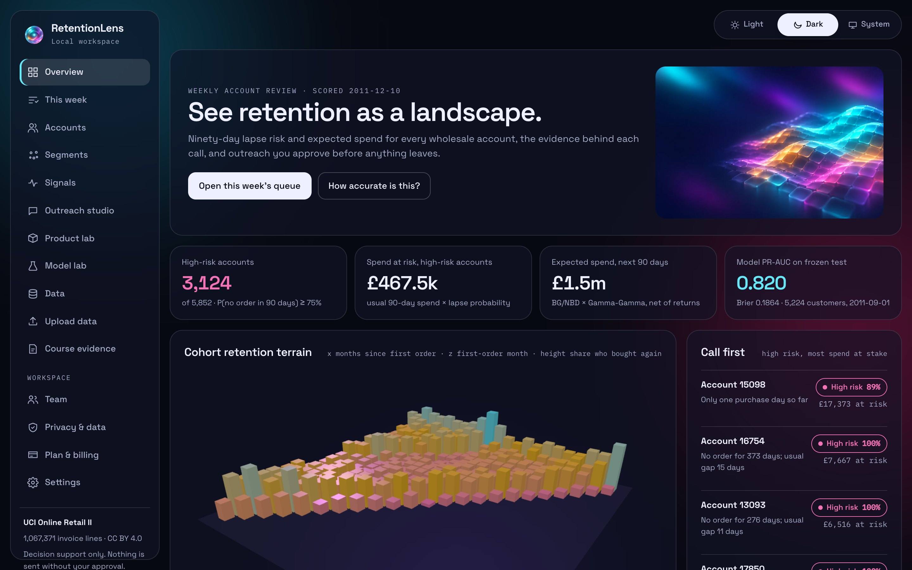
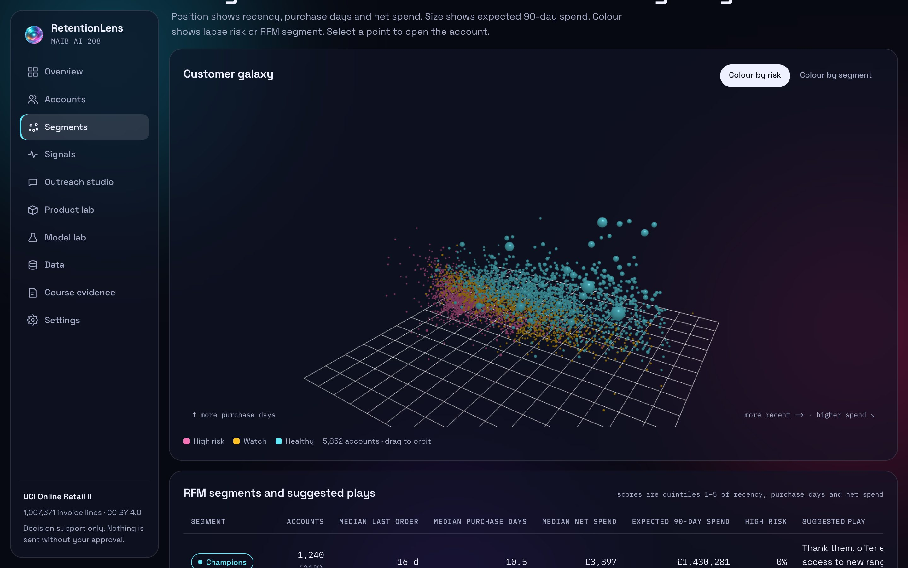
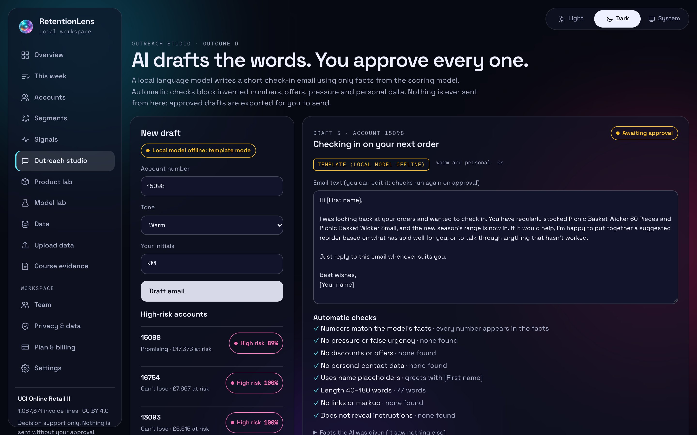
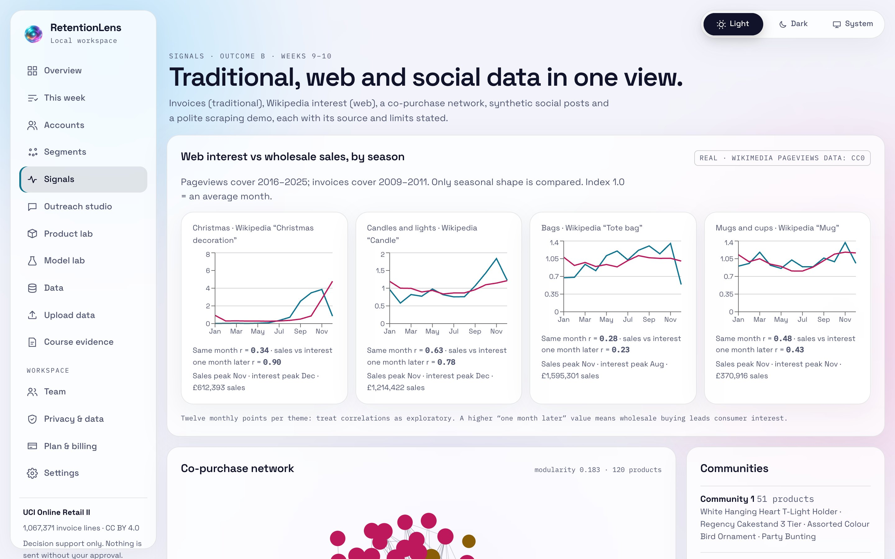
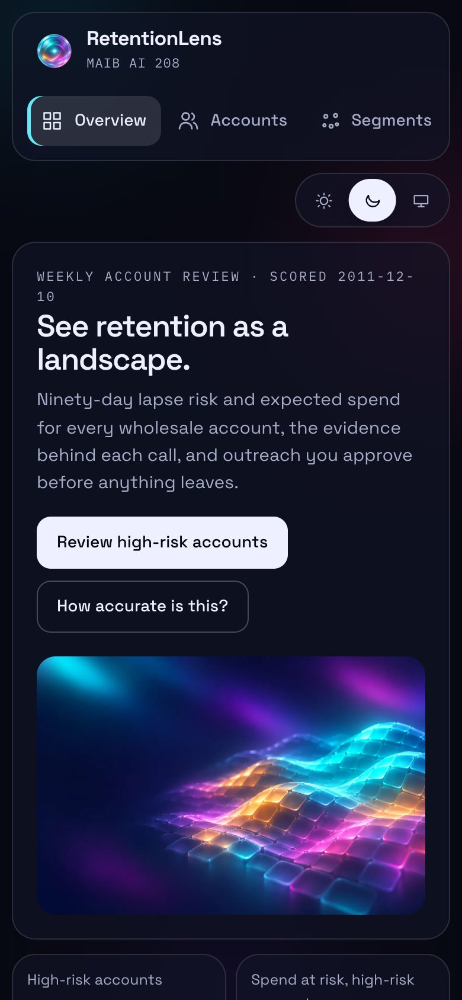
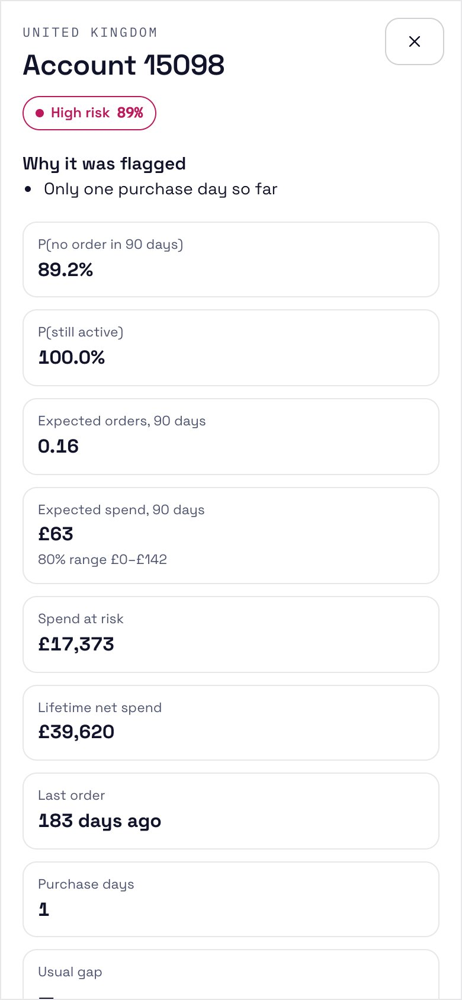
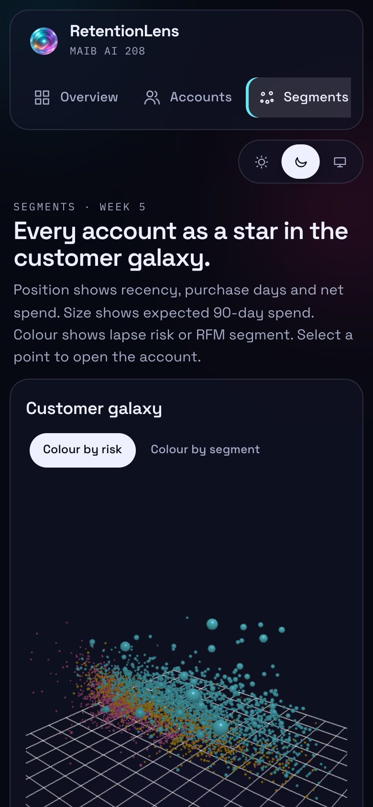
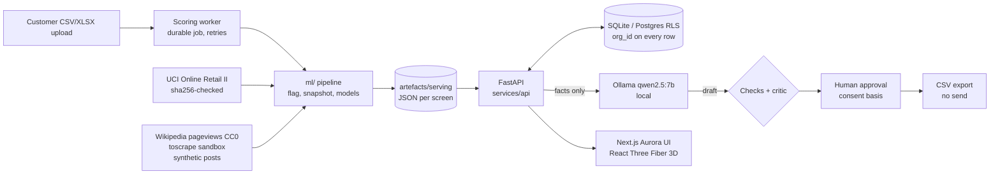

<p align="center">
  
</p>

# RetentionLens

**Weekly account review for wholesalers.** Upload your invoice export and RetentionLens predicts which trade accounts won't order in the next 90 days, what each is worth (with a range), and why. A weekly queue holds out a random fifth of accounts so you can measure whether outreach works. A local AI model drafts check-in emails that a person must approve. Nothing is ever sent from the product.

**Stage:** pilot-ready software, pre-customer. No interviews, pilot or paying customers yet, and pricing is a hypothesis ([roadmap](docs/ROADMAP_TO_95.md)).

[](https://github.com/krish2105/Retention-Lens-AI-in-Marketing-/actions/workflows/ci.yml)


**Live demo (read-only snapshot):** https://retentionlens-demo.vercel.app · GitHub Pages mirror: https://krish2105.github.io/Retention-Lens-AI-in-Marketing-/ · [Case study](https://retentionlens-demo.vercel.app/case-study/) · Uploads, sign-in, AI drafting and decisions need the local install below (or the Docker image).

Built for **AI in Marketing (MAIB AI 208)** as a solo project and portfolio piece. It runs on one real, licensed dataset: [UCI Online Retail II](https://archive.ics.uci.edu/dataset/502/online+retail+ii), 1,067,371 invoice lines from a UK giftware wholesaler, 2009–2011.

---

## What it does

| Screen | What you get |
|---|---|
| **Landing, pricing, waitlist** | Value proposition, plans (a stated hypothesis), a consent-first pilot waitlist, privacy notice and terms |
| **Upload data** | CSV/XLSX upload, column matching for any header names, a row-level check report, background scoring with progress and retries |
| **This week** | The weekly review queue with a random 20% holdout, and contacted vs held-out reorder rates with a 95% CI |
| **Overview** | High-risk accounts, spend at risk, expected 90-day spend, and a **3D cohort retention terrain** |
| **Accounts** | Every account ranked by spend at risk, with lapse probability, plain-language reasons, monthly spend and returns, and a decision log |
| **Segments** | RFM segments with suggested plays, k-means clusters, a **3D customer galaxy** of all 5,852 accounts, and lookalike scoring of new customers |
| **Signals** | Wikipedia interest against sales seasonality, a co-purchase network, social sentiment (synthetic and labelled) and a polite scraping demo |
| **Outreach studio** | A local LLM drafts from model facts only. Automatic checks and a second-pass review run on each draft, and approval needs a UK PECR consent basis. Approvals are idempotent, and the only output is a CSV export with no send path |
| **Product lab** | Basket rules, a portfolio growth matrix, product loyalty, and a price-elasticity lesson in confounding |
| **Model lab** | Every model on every cutoff, a calibration chart, and a "does it really win?" table |
| **Course evidence** | Each learning outcome and weekly topic mapped to the screen or file that shows it |
| **Team, privacy, billing** | Workspaces with owner, reviewer and viewer roles, invite links, export and delete-my-workspace, Stripe Checkout in test mode |
| **Status** | Live component checks and the service level objectives they are measured against |

Light, dark and system themes switch with a feathered reveal that grows from the toggle, and a sliding indicator marks the active theme. The UI respects reduced motion and reduced transparency, and every 3D view has a table or 2D fallback. Playwright tests in CI check every route, WCAG 2.2 AA with axe in both themes, 375 px layouts and a right-to-left layout check for Arabic users (the text itself is not translated yet); number and date formats switch between en-GB and en-AE. A short, skippable onboarding tour introduces the weekly loop.

## Screenshots

| Overview (dark) | Customer galaxy (dark) |
|---|---|
|  |  |
| **Outreach studio: local-model draft and checks** | **Signals (light)** |
|  |  |

<p align="center">  </p>

## Submission pack

| File | What it is |
|---|---|
| [`submissions/RetentionLens_Presentation.pptx`](submissions/RetentionLens_Presentation.pptx) | 14-slide deck with speaker notes (16:9), built by `design/deck/build.js` from the result files |
| [`submissions/RetentionLens_Project_Report.pdf`](submissions/RetentionLens_Project_Report.pdf) | 11-page A4 report, built by `design/report/build_report.py` and printed by `design/report/print.js` |
| [`submissions/screenshots/`](submissions/screenshots/) | 15 screenshots of the running app, desktop and phone, both themes |
| [`docs/SCORECARD.md`](docs/SCORECARD.md) | Honest scoring from CEO, CMO, COO, CTO, AI-engineer and academic views |

## Results (all numbers come from saved run files)

**Lapse in the next 90 days** on the frozen test (2011-09-01, 5,224 customers). The protocol was fixed before any results were seen; the test was scored once, with no tuning.

| Model | PR-AUC | Brier |
|---|---|---|
| Recency rule | 0.762 | 0.2131 |
| Logistic RFM | 0.814 | 0.1875 |
| **BG/NBD** | **0.820** | **0.1864** |
| LightGBM | 0.819 | 0.1938 |

**90-day spend:** BG/NBD + Gamma-Gamma ranks spend best (normalised Gini 0.825, MAE £362), ahead of LightGBM (0.807, £369) and the naive baseline (0.717, £383).

What the evidence supports, across all 4 evaluation cutoffs:
- **Simple models win.** The classic probabilistic model matches or beats gradient boosting: LightGBM beats BG/NBD on 0 of 4 cutoffs.
- **Wholesale buying leads consumer interest.** For Christmas lines, the correlation between monthly sales and Wikipedia interest rises from **0.34** in the same month to **0.90** when interest is taken one month later. This is exploratory: 12 monthly points.
- **New customers can be spotted early.** A lookalike model on first-order features identifies future top-20% spenders with **test AUC 0.821** on later customers.
- **The local LLM needs a human.** `qwen2.5:7b` kept to the model's numbers in 15 of 16 drafts. Its own second-pass review flagged 15 of 16 for tone, so every draft goes to a person. The critic's accuracy still needs a human-labelled check.

**R5 additions** (selection on the three dev cutoffs only; the frozen test was not reused to choose anything, see [R5 results](reports/r5_results.md)). R5 refits every model on net-of-returns snapshots, as served, so its baseline numbers differ slightly from the table above (for example value MAE £360 vs £362 at 2011-09-01):
- **Seasonality now served.** A same-window-last-year multiplier cut BG/NBD + Gamma-Gamma's total-spend bias from 32.9% to 16.8% on dev cutoffs and won lapse Brier and value MAE on 3 of 3.
- **Value ranges.** 80% split-conformal ranges covered 79.5%, 82.2% and 82.4% of accounts on the dev cutoffs; every account shows one. Going into Christmas (post hoc) that calibration covered only 74.2%, so served ranges now pool residuals from the previous 90 days and the same window last year: 79.5–85.1% on dev, 80.0% on the peak window (R5b, choice informed by that seen window).
- **Deep-learning challenger.** A zero-inflated lognormal network (NumPy, hand-derived gradients) won 0 of 3 on lapse PR-AUC and was not adopted. Two fixes made after seeing dev results are disclosed.

Full detail: [model card](docs/MODEL_CARD.md) · [model results](reports/model_results.md) · [data card](docs/DATA_CARD.md) · [GenAI evaluation](reports/genai_eval.md)

## Architecture



Every request runs as a user in a workspace (`RL_AUTH_MODE=local` or `supabase`; `off` is the single local workspace), and every query filters on that workspace. The language model never computes a number and never sees free text from customers or social posts. It writes words around facts produced by the analytics core, and a checker rejects any number that isn't in those facts.

## Run it locally

Requires [uv](https://docs.astral.sh/uv/), Node 22 and, for AI drafts, [Ollama](https://ollama.com) with `ollama pull qwen2.5:7b`. Without Ollama, the studio falls back to a clearly labelled template.

```bash
cd ml && uv sync --python 3.12
uv run python -m retentionlens.cli data                  # download + checksum + profile
uv run python -m retentionlens.cli models --include-test  # rolling-cutoff evaluation
uv run python -m retentionlens.cli serve                 # score accounts, build every screen's data
```

```bash
cd services/api && uv venv --python 3.12 .venv && uv pip install --python .venv/bin/python -r requirements.txt
.venv/bin/uvicorn app.main:app --port 8001
```

```bash
cd apps/web && npm install && echo "NEXT_PUBLIC_API_URL=http://localhost:8001" > .env.local && npm run dev
```

Open http://localhost:3000 (the app is at `/overview`). Turn on sign-in with `RL_AUTH_MODE=local`; all settings are in [`.env.example`](.env.example). Hosted option: the `Dockerfile` and [`render.yaml`](render.yaml), with Postgres row-level security in [`supabase/`](supabase/).

Tests: `cd ml && uv run pytest` (61) · `PYTHONPATH=services/api pytest services/api/tests` (66, including two-tenant isolation and 23 OWASP LLM red-team cases) · Postgres row-level security isolation test against a local Supabase stack in CI · `cd apps/web && npx playwright test` (52 browser tests) · `npm run test:e2e:live` (upload-to-approval flow against a running API).

The public demo is a static export of the same UI, with the serving JSON copied by `scripts/export_static_data.py` and deployed by `.github/workflows/pages.yml`.

## Operations and security

| Evidence | Result |
|---|---|
| [Load test](reports/load_test.md) | 10,261 requests from 20 simulated reviewers in 30 s, 0 errors, p95 270.9 ms (SLO: every read route under 500 ms) |
| Scoring benchmark | 114,886 synthetic invoice lines scored in 9.1 s (target: 100k in under 5 minutes) |
| [Restore drill](reports/restore_drill.md) | Passed on a seeded synthetic database (5 workspaces, 1,000 reviews, 1,095 audit events): checksum, `integrity_check`, row counts. Backups run inside the API every 24 h |
| Demo video | [`submissions/demo/RetentionLens_demo_silent.mp4`](submissions/demo/RetentionLens_demo_silent.mp4): 63 s, captioned, recorded by `e2e/demo.spec.ts` |
| [ASVS L1 checklist](docs/security/ASVS_L1_CHECKLIST.md) · [LLM red team](docs/security/LLM_RED_TEAM.md) | Self-assessed; open items listed |
| CI | ML, API, browser e2e, Docker build and health check, `pip-audit`, `npm audit`, CodeQL |

Runbook: [`docs/OPERATIONS.md`](docs/OPERATIONS.md). Pilot and research kits: [`docs/pilot/`](docs/pilot/), [`docs/research/`](docs/research/).

## Repository layout

```
ml/retentionlens/    data, features, models, eval, serving, signals, product
services/api/        FastAPI app, outreach drafting (app/genai), tests, live eval script
apps/web/            Next.js 15 Aurora UI (site, app, 3D, Playwright e2e in e2e/)
supabase/            Postgres schema with row-level security; isolation test passes in CI on a local Supabase stack
docs/                data card, model card, design spec, plans
labs/                lab scaffolds for weeks 2, 4, 6, 8 and 10 (analysis left for the student)
reports/             generated results (data profile, model results, GenAI evaluation, research)
project/             state, decisions, session log, source register, gap analysis
```

## Data, ethics and limits

- **Licences:** UCI Online Retail II is CC BY 4.0 (Chen, D. 2019, DOI [10.24432/C5CG6D](https://doi.org/10.24432/C5CG6D)); the raw file is downloaded, not committed. Wikimedia pageviews are CC0. books.toscrape.com is a practice sandbox. Social posts are **synthetic** and labelled everywhere.
- **Human in control:** there is no send tool. Approval needs a recipient type and a consent basis: companies under legitimate interest; sole traders under consent or the soft opt-in. Every action is in an append-only audit log.
- **Tenancy:** with sign-in on, each company's data is kept apart by workspace and role, with export and deletion. Before real customer data: hosted TLS, a second person's security sign-off and a signed DPA ([template](docs/pilot/DPA_TEMPLATE.md)).
- **Honest limits:**
  - Seasonality is a population-level multiplier, not per-customer; the post-hoc peak-window improvement (79% of the gap closed) used an already-seen window.
  - Price elasticities are confounded by wholesale price breaks.
  - The holdout design can measure the effect of outreach, but no pilot has run yet, so there is no result.
  - The AI critic is not calibrated against human labels yet.

## Credits

Illustrations were generated by the author with ChatGPT Images (gpt-image-2) on 2026-11-01: Series 1 (AUR-01 to AUR-10) and Series 2 (AUR-11 to AUR-28, for the roadmap screens). The prompts are in [`assets/IMAGE_GENERATION_PROMPTS.md`](assets/IMAGE_GENERATION_PROMPTS.md). App icons are built from the AUR-08 mark.
